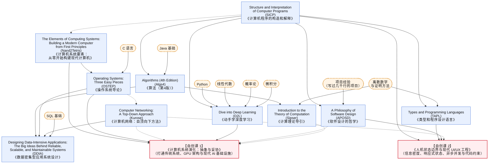

# 计算机科学个人学习体系：全局导航与阅读指南

这套学习体系由 **10 本计算机科学经典教材** 和 **2 门自创进阶课程** 组成：

* **10 本经典教材**：打牢计算机科学的基础，涵盖编程抽象、硬件构造、数据结构、操作系统、计算机网络、分布式数据系统、软件设计、类型系统、计算理论和深度学习。
* **2 门自创进阶课**：在经典教材的基础上，补齐现代计算机工程中最关键的两个方向：
  1. **底层硬件与现代 AI 系统**：[《计算机系统演化：抽象与妥协》](./计算机系统演化_抽象与妥协/README.md)（[16周教学与实验大纲](./计算机系统演化_抽象与妥协/16周完整教学与沙盒实验大纲.md)）
  2. **人机交互与前端状态工程**：[《人机状态边界与现代 UI/UX 工程》](./人机状态边界与现代UI工程/README.md)（[16周教学与工坊大纲](./人机状态边界与现代UI工程/16周完整教学与对抗工坊大纲.md)）

---

## 一、 课程与书单的前置依赖图

---

## 二、 阅读建议：减少语言负担，抓核心章节

1. **不必专门去学五门编程语言**
   这十本书分别用到了 Scheme（`SICP`）、Java（`Algs4`）、C（`OSTEP`）、OCaml（`TAPL`）和 Python（`D2L`）。阅读时重点看原理，不必在语言细节上耗费过多精力：
   * `SICP` 可以直接看官方的 JavaScript 版（SICP JS），或者只花半小时了解一点最基础的括号语法；
   * `Algs4` 里的 Java 代码只用了最基本的数组、类和泛型，直接当伪代码读即可；
   * `TAPL` 里的类型规则，完全可以用日常熟悉的 **TypeScript 或 Rust** 来对照理解。
2. **挑重点章节读**
   经典教材为了照顾体系完整，往往包含很多历史遗留内容或纯粹的数学证明。下面列出了每本书真正值得精读的部分和可以略过的部分。

---

## 三、 核心十本书：每本书看什么、略过什么

### 1. 《计算机程序的构造和解释》(SICP)

* **核心内容**：讲清楚程序是怎么通过函数、数据结构和状态组织起来的。
* **重点章节**：
  * **第 1 章（构造过程抽象）**：高阶函数、递归与迭代在内存空间上的区别、时间复杂度初步。
  * **第 2 章（构造数据抽象）**：**重点看 2.1 \~ 2.2 节**。理解怎么用基本序对拼出列表和树——这是理解语法树（AST）和前端组件树的基础。
  * **第 3 章（模块化、对象和状态）**：**重点看 3.1 节（引入变量赋值后带来的代价）、3.4 节（并发问题）、3.5 节（流与按需计算）**。这一章讲透了为什么程序一旦引入“可变状态”，复杂度就会急剧上升。
  * **第 4 章（元语言抽象）**：**只精读 4.1 节**。看懂怎么用百来行代码写出一个能解释自己的求值器（`eval` 与 `apply`），彻底明白编程语言解释器是怎么工作的。
* **可以略过**：2.4\~2.5 节复杂的通用算术包例子、4.2\~4.4 节其他变体解释器、第 5 章寄存器机器（硬件部分直接看后面的 `Nand2Tetris` 更直观）。
* **关联自创课**：为 [《现代 UI 工程》](./人机状态边界与现代UI工程/16周完整教学与对抗工坊大纲.md) 中的声明式视图、响应式数据流和语法树代码检查打底。

---

### 2. 《计算机系统要素》(Nand2Tetris / N2T)

* **核心内容**：从最简单的“与非门（NAND）”开始，一步步搭出算术逻辑单元（ALU）、寄存器、内存、CPU、汇编器和虚拟机。
* **重点章节（也可以配合 Steam 上的《图灵完备》游戏一起做）**：
  * **第 1 \~ 3 章（布尔逻辑、算术运算、时序逻辑）**：搞懂电路是怎么做加法的，以及时钟信号是怎么让电路“记住”数据的。
  * **第 4 \~ 6 章（机器语言、计算机体系结构、汇编器）**：亲手把前面做的部件连成一个能跑指令的 CPU，理解二进制机器码是怎么控制硬件干活的。
  * **第 7 \~ 8 章（虚拟机）**：理解高级语言里的函数调用栈（Call Stack）和局部变量在内存里到底是怎么存放的。
* **可以略过**：第 9 \~ 12 章（手写高级语言解析器和简易操作系统库，了解大意即可，不必花几十个小时去敲字符串处理代码）。
* **关联自创课**：`Nand2Tetris` 造的是最简单的单周期 CPU，没有流水线、没有缓存、也没有 GPU。读完它的前 8 章后，正好接上 [《计算机系统演化》](./计算机系统演化_抽象与妥协/16周完整教学与沙盒实验大纲.md) 的前 4 周，继续学习现代 CPU 流水线、分支预测和 GPU 并行架构。

---

### 3. 《算法（第 4 版）》(Algs4)

* **核心内容**：工程中最常用的四类基础算法——排序、查找（树与哈希表）、图算法、字符串处理。
* **重点章节**：
  * **第 1 章（基础）**：**1.3 节（动态数组扩容 vs 链表）与 1.5 节（并查集 Union-Find）**。
  * **第 2 章（排序）**：归并排序、快速排序、**优先队列与二叉堆（Heap，任务调度器与取前 K 大元素的基础结构）**。
  * **第 3 章（查找）**：二分查找、**红黑树（重点看 2-3 树的平衡原理，不用死背旋转代码）**、哈希表（拉链法与开放寻址法对缓存的友好程度对比）。
  * **第 4 章（图）**：深度/广度优先搜索、**有向无环图（DAG）的拓扑排序**（依赖分析的基础）、最短路径算法。
  * **第 5 章（字符串）**：**5.2 节（前缀树 Trie，代码补全和大模型前缀缓存的基础）**、5.4 节（正则表达式背后的状态机原理）。
* **可以略过**：书中用于画图的 Java 库细节、红黑树删除节点时冗长的边界处理代码。

---

### 4. 《操作系统导论》(OSTEP)

* **核心内容**：全书围绕操作系统的三件事展开——**虚拟化**（怎么让多个程序共享 CPU 和内存）、**并发**（多线程同时改数据怎么不出错）、**持久化**（断电重启后硬盘数据怎么保持完整）。
* **重点章节**：
  * **第一部分：虚拟化（第 4 \~ 23 章）**：
    * 进程上下文切换的开销、操作系统怎么收回 CPU 控制权；
    * 进程调度算法（怎么同时照顾短任务的响应速度和长任务的吞吐量）；
    * **虚拟内存分页、快表（TLB）、多级页表与内存换出机制**。
  * **第二部分：并发（第 26 \~ 33 章）**：
    * 锁的硬件实现原理、条件变量、常见死锁成因；
    * **第 33 章（基于事件的并发）**：理解单线程事件循环和异步 I/O 是怎么处理高并发的。
  * **第三部分：持久化（第 36、40、42\~43 章）**：
    * 中断与轮询的取舍、文件系统结构、**预写式日志（WAL）如何防止崩溃后数据损坏**。
* **可以略过**：第 37\~38 章关于传统机械硬盘磁头寻道时间的计算和老式磁盘阵列（RAID）细节。
* **关联自创课**：直接对应 [《计算机系统演化》](./计算机系统演化_抽象与妥协/16周完整教学与沙盒实验大纲.md) 的第 5 \~ 8 周（把操作系统的分页内存管理对比到大模型的 PagedAttention，把进程切换开销对比到 GPU 的多线程延迟掩盖机制）。

---

### 5. 《计算机网络：自顶向下方法》(Kurose & Ross)

* **核心内容**：从日常接触的 HTTP 应用层往下拆解，看计算机怎么在会丢包、有延迟的网络链路上实现可靠传输。
* **重点章节（重点精读前 3 章即可）**：
  * **第 1 章（概述）**：分清 **传输延迟、传播延迟（受光速限制）、排队延迟、处理延迟**，理解带宽和延迟的关系。
  * **第 2 章（应用层）**：HTTP/1.1 的队头阻塞问题、HTTP/2 的多路复用、HTTP/3 (QUIC) 以及 DNS 缓存机制。
  * **第 3 章（传输层）**：
    * 3.4 节（可靠传输的基本原理：序列号、确认应答、超时重传、滑动窗口）；
    * 3.5 \~ 3.7 节（TCP 的连接管理、流量控制和拥塞控制原理）。
* **可以略过**：第 4\~5 章复杂的运营商路由协议（OSPF/BGP 细节）、第 6\~7 章底层网线和无线电信号帧格式。
* **关联自创课**：支撑 [《计算机系统演化》](./计算机系统演化_抽象与妥协/16周完整教学与沙盒实验大纲.md) 第 9\~10 周的高性能网络通信，以及 [《现代 UI 工程》](./人机状态边界与现代UI工程/16周完整教学与对抗工坊大纲.md) 第 8\~9 周的弱网处理与数据同步。

---

### 6. 《数据密集型应用系统设计》(DDIA)

* **核心内容**：讲透现代后端与分布式系统在面对海量数据和高并发时，在存储、事务和一致性上所做的权衡。
* **重点章节**：
  * **第一部分（数据系统基础，第 1 \~ 4 章）**：
    * **第 3 章（存储与检索）**：深入对比 **LSM-Tree（写数据快）和 B-Tree（读数据快）** 两种数据库底层存储引擎的优缺点；
    * **第 4 章（编码与演化）**：数据格式升级时怎么保证新老版本程序互相兼容。
  * **第二部分（分布式数据，第 5 \~ 9 章）**：
    * **第 5 章（复制）**：主从复制延迟带来的问题（比如刚写完的数据自己却读不到）、多节点读写策略；
    * **第 7 章（事务）**：多版本并发控制（MVCC）、快照隔离，以及脏写、幻读、写偏斜等并发异常；
    * **第 8 章（分布式系统的隐患）**：网络故障、**多台机器之间时钟不一致的问题**、垃圾回收暂停导致的分布式故障；
    * **第 9 章（一致性与共识）**：分布式共识算法（Raft / Paxos）解决的核心问题与代价。
  * **第三部分（派生数据，第 11 章）**：流处理与事件溯源（Event Sourcing）。

---

### 7. 《软件设计的哲学》(APOSD)

* **核心内容**：一本不到 200 页的小册子，专门探讨“什么样的代码结构容易维护，什么样的代码结构只会增加复杂度”。
* **重点章节（篇幅很短，建议全读）**：
  * **第 2 \~ 3 章**：软件复杂度的来源，为什么每次只图省事打补丁会让系统越来越难改；
  * **第 4 \~ 5 章（核心观点：模块要“深”）**：好的模块应该**对外接口尽量简单，把复杂的实现逻辑藏在内部（深模块）**；如果一个模块对外暴露了一大堆配置和接口，内部却没干多少实事（浅模块），就会大幅增加使用者的心智负担；
  * **第 7 \~ 10 章**：**把复杂度往下层压**（让框架和底层多担待，让上层业务代码保持简单）、通过合理设计接口把特殊报错情况自然消除掉。
* **关联自创课**：直接指导 [《计算机系统演化》](./计算机系统演化_抽象与妥协/16周完整教学与沙盒实验大纲.md) 第 11\~12 周的底层编程抽象，以及 [《现代 UI 工程》](./人机状态边界与现代UI工程/16周完整教学与对抗工坊大纲.md) 第 10 周的无样式逻辑组件（Headless UI）设计。

---

### 8. 《类型和程序设计语言》(TAPL)

* **核心内容**：讲解编程语言类型系统的数学原理，看编译器怎么在代码运行前抓出逻辑漏洞。
* **重点章节（重点理解概念，不必深究书里的数学归纳证明过程）**：
  * **第 5 \~ 9 章（$\lambda$ 演算与简单类型）**：理解类型系统是怎么保证程序不会执行出未知状态的；
  * **第 11 章（复合类型：结构体、枚举/联合类型、模式匹配检查）**：理解怎么用**联合类型（Sum Types / Variants）**把业务状态定义清楚，让编译器帮你拦住不合法的状态组合；
  * **第 15 \~ 16 章（子类型）**：结构化类型、函数参数的**逆变**与返回值的**协变**；
  * **第 22 \~ 23 章（类型推导与泛型）**：理解编译器自动推导类型的原理。
* **可以略过**：各章冗长的定理证明过程、第 18\~19 章用函数模拟面向对象的推导、第 26 章以后的高阶类型系统。
* **关联自创课**：直接用于 [《现代 UI 工程》](./人机状态边界与现代UI工程/16周完整教学与对抗工坊大纲.md) 第 5 周的状态机建模，以及第 12 周用类型系统约束 AI 生成的代码。

---

### 9. 《计算理论导引》(Sipser)

* **核心内容**：回答计算机科学最根本的三个问题——什么问题用简单状态机就能算？什么问题必须用通用计算机才能算？什么问题再快的计算机也算不出来？
* **重点章节**：
  * **第一部分：自动机与语言（第 1 \~ 2 章）**：有限状态机（DFA/NFA）、正则表达式的能力边界（为什么正则表达式没法正确匹配任意层数的括号嵌套）、上下文无关文法（CFG）；
  * **第二部分：可计算性理论（第 3 \~ 5 章）**：图灵机模型、**停机问题为什么不可判定**、**莱斯定理（为什么不可能写出一个能自动检查任意代码所有运行时逻辑错误的万能工具）**；
  * **第三部分：复杂性理论（第 7 章）**：$\text{P}$ 问题与 $\text{NP}$ 问题（**为什么“自己从头算出一个答案”往往极难，但“检查别人给的答案对不对”却很快**）。
* **可以略过**：第 6 章和第 8\~10 章偏纯理论的复杂性证明。
* **关联自创课**：直接对应 [《计算机系统演化》](./计算机系统演化_抽象与妥协/16周完整教学与沙盒实验大纲.md) 第 13\~14 周——正因为“生成答案难、验证答案易”，我们才把擅长猜答案的大模型和擅长做严格验证的状态机、编译器结合起来。

---

### 10. 《动手学深度学习》(D2L)

* **核心内容**：结合数学公式与代码，从最简单的线性回归一路讲到 Transformer 大模型架构。
* **重点章节（推荐配合 Andrej Karpathy 的《Zero to Hero》视频一起看）**：
  * **第 2 \~ 5 章（基础与多层感知机）**：矩阵运算、自动求导（反向传播计算图）、参数初始化与梯度消失/爆炸问题；
  * **第 7 \~ 8 章（卷积网络中的核心设计）**：重点看 **残差连接（ResNet，为什么加一条跨层直连就能训练极深的网络）** 和归一化层（LayerNorm）；
  * **第 9 \~ 11 章（序列模型、注意力机制与优化算法）**：注意力机制原理、**自注意力（Self-Attention）与 Transformer 架构细节**、Adam 优化算法。
* **可以略过**：传统图像目标检测里复杂的候选框细节、早期循环神经网络（RNN/LSTM）的各种变体推导。
* **关联自创课**：学完第 10 章的 Transformer 结构后，直接进入 [《计算机系统演化》](./计算机系统演化_抽象与妥协/16周完整教学与沙盒实验大纲.md) 的偶数周课程，学习怎么把 Transformer 模型通过量化、显存分页、算子融合与多卡并行真正跑起来。

---

## 四、 推荐学习顺序（四个阶段）

| 阶段 | 核心目标 | 经典教材章节 | 配套自创课程 |
| :---: | :--- | :--- | :--- |
| **第一阶段** *(打牢单机基础)* | **掌握编程抽象、CPU 构造与操作系统核心** | 1. `SICP` (第 1\~4.1 章) 2. `Nand2Tetris` (第 1\~8 章) 3. `OSTEP` (虚拟化 + 并发) | 建立从逻辑门、函数调用栈到虚拟内存和进程调度的整体认识。 |
| **第二阶段** *(算法、网络与设计)* | **掌握常用数据结构、网络传输与类型设计** | 1. `Algs4` (树/哈希/图/前缀树) 2. `Kurose 网络` (前 3 章) 3. `APOSD` + `TAPL` (复合类型与子类型) | 掌握图算法、TCP 可靠传输机制、模块化设计原则与强类型建模。 |
| **第三阶段** *(人机交互与前端工程)* | **掌握高密度界面、响应式状态、异步并发与代码检查** | 综合运用 `SICP` + `TAPL` + `APOSD` | **学习【自创课 2】** [《人机状态边界与现代 UI/UX 工程》](./人机状态边界与现代UI工程/README.md) |
| **第四阶段** *(分布式与 AI 系统)* | **掌握分布式存储、GPU 并行架构与大模型推理系统** | 1. `DDIA` (存储引擎 + 事务 + 共识) 2. `Sipser` (自动机与可计算性) 3. `D2L` (自动求导与 Transformer) | **学习【自创课 1】** [《计算机系统演化：抽象与妥协》](./计算机系统演化_抽象与妥协/README.md) |
