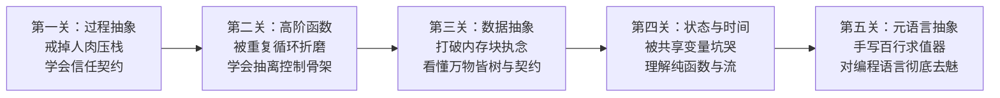

# 《计算机程序的构造和解释》(SICP) 导读：从初学卡点到核心顿悟

* **推荐阅读范围**：第 1 章 \~ 第 4.1 节（详见 [全局指南](../guide#1-计算机程序的构造和解释-sicp)）
* **推荐版本**：直接阅读官方 JavaScript 版（*SICP JS*），或仅花半小时了解 Scheme 最基础的括号前缀语法，不必在语言细节上恋战。

---

## 一、 为什么初学者直接啃 `SICP` 极易卡住？

初学者刚学编程时，脑子里的默认模型是**“步进式指令机器”**——先定义变量 `a`，再跑一个 `for` 循环改写 `a`，最后打印结果。

而 `SICP` 从第一页起，讲的根本不是“怎么命令机器干活”，而是**“当软件系统的规模大到人类大脑装不下时，如何用抽象来压制复杂度”**。

用一套“解决大型系统复杂度”的哲学去教一个“还没写过几百行代码”的初学者，就像给还没走稳路的人讲空气动力学。要真正读懂 `SICP` 并在脑子里长出肌肉，必须经历以下**五个阶段的“碰壁 $\rightarrow$ 破局 $\rightarrow$ 顿悟”心路历程**。



---

## 二、 五大核心关卡的心路历程与破局路线

### 第一关：从“人肉追踪每一步”到“信任契约”（第 1.1 \~ 1.2 节）

#### 1. 初学者的卡壳心态
看到树形递归（如换零钱、汉诺塔）时，初学者本能地想当“人肉调试器”——在脑子里把第 1 层调用、第 2 层调用、第 3 层调用一层层展开。一旦超过 3 层，大脑工作记忆直接溢出，于是觉得“递归反人类、像玄学”。

#### 2. 破局实操路线
* **亲手画一次“计算过程的形状”**：
  拿一张纸，用书中的“代换模型”把阶乘或斐波那契数列展开：
  * 看看**线性递归**是怎么先横向拉长成一串“悬而未决的算式”（吃掉 $\mathcal{O}(n)$ 的调用栈空间），最后再一层层收回来的；
  * 再看看**尾递归/线性迭代**是怎么把所有中间结果都装进参数里，每一步都干干净净（只占 $\mathcal{O}(1)$ 空间）的。
* **强迫练习“心想事成法（Wishful Thinking）”**：
  写递归函数时，强行忍住不去想下一层是怎么跑的。直接假设**“规模为 $n-1$ 的子问题已经有人帮我写好，并且绝对正确”**，我只需要写好两件事：
  1. 拿到 $n-1$ 的结果后，最后一步怎么拼成 $n$ 的结果？
  2. 当 $n=0$ 或 $n=1$ 的最小边界时，直接返回什么？

#### 3. 顿悟时刻
你突然戒掉了“人肉进栈”的强迫症，学会了**把函数签名当成一份契约来信任**；同时你第一次具备了“透视眼”——光看一眼代码的递归结构，脑子里就能浮现出它在内存里是“越积越高的欠债”还是“原地更新的账本”。

---

### 第二关：从“复制粘贴循环”到“把动作打包传递”（第 1.3 节：高阶函数）

#### 1. 初学者的卡壳心态
书里一上来就用高阶函数求数列和 $\sum f(x)$、求不动点（$\text{fixed-point}$）和牛顿法求根。初学者一方面被数学公式吓退，另一方面想不通：“好端端的写个 `for` 循环三行就算完了，为什么要把函数传给函数，再返回一个新函数？这不是故意绕弯子吗？”

#### 2. 破局实操路线
* **先受“复制粘贴”的苦**：
  不要一上来就看书里的数学例子。先自己写 4 个日常小函数：
  1. 遍历数组把每个数字乘以 2；
  2. 遍历数组把每个字符串加上前缀；
  3. 遍历数组筛选出所有偶数；
  4. 遍历数组把所有元素加起来。
* **做“挖空填空题”**：
  把这几段代码并排放在一起，你会发现“新建结果容器、循环遍历、取元素”的骨架一模一样，唯一不同的只有循环体里面那一行操作。把那一行挖空，变成参数 `fn` 传进去——你就亲手发明了 `map`、`filter` 和 `reduce`。

#### 3. 顿悟时刻
你突然明白高阶函数不是数学家的炫技，而是**把“怎么遍历的控制流骨架”和“到了每个节点具体干什么的业务动作”彻底拆开**。函数不再是一段死代码，而是变成了可以打包放进变量、装进数组、到处传递的“动作胶囊”。

---

### 第三关：“数据到底是什么？”的幻灭与重建（第 2.1 \~ 2.2 节）

#### 1. 初学者的卡壳心态
读到 2.1.3 节时，作者不用数组、不用结构体对象，只写了三个几行代码的函数（`cons`、`car`、`cdr`），光靠返回闭包函数就把两个数字组装成了一个“序对（Pair）”。绝大多数初学者看到这里会瞳孔地震：“连个存数据的内存块都没有，数据到底存在哪儿了？！”

```javascript
// 不用任何数组或对象，仅靠函数闭包实现“数据结构”
function cons(x, y) {
  return (m) => m === 0 ? x : y;
}
function car(z) { return z(0); }
function cdr(z) { return z(1); }
```

#### 2. 破局实操路线
* **设立“抽象屏障（Abstraction Barrier）”**：
  写一个处理二叉树的小程序，给自己定死规矩：上层业务代码只准调用 `makeNode`、`leftBranch`、`rightBranch` 三个接口，严禁直接用数组下标 `node[0]`。写完后，把底层实现从“数组”偷偷换成上面的“纯函数闭包”，亲眼验证上层代码一行不改就能正常跑通。
* **体验“闭合性质（Closure Property）”搭积木**：
  只用只能装两个元素的 `cons(a, b)`：右边装下一个序对，就串成了**单链表**；左边和右边都装序对，瞬间就长出了一棵**任意深度的树**。

#### 3. 顿悟时刻
1. **“数据”与“函数”的界限彻底消失**：所谓数据结构，本质上不过是一组遵守了存取契约（只要满足 `car(cons(x, y)) === x` 且 `cdr(cons(x, y)) === y`）的行为集合。
2. **两块积木搭出整个世界**：只要组合出来的结果还能继续用同一种方式再组合（闭合性质），哪怕手里只有最简陋的二元序对，也能一路拼出链表、JSON、HTML DOM 树和编译器语法树（AST）。

---

### 第四关：从“随手改变量很爽”到明白“可变状态是万恶之源”（第 3.1、3.4、3.5 节）

#### 1. 初学者的卡壳心态
前两章完全不准修改变量（没有赋值语句 `set!`），初学者觉得束手束脚；到了第 3 章终于引入变量赋值了，初学者的第一反应往往是“太棒了，终于回到正常写代码的舒适区了！”，根本无法理解作者为什么用近乎悲壮的语气剖析“赋值的代价”。

#### 2. 破局实操路线
* **亲手制造一次“状态泥潭”**：
  写一个包含多个模块共享状态对象的程序（或者模拟两个异步请求同时读写同一个余额变量）。你会发现：
  * 前两章最好用的“代换模型”彻底作废了——同一个函数调用 `withdraw(25)`，第一次调返回 `75`，第二次调却返回 `50`；
  * 为了搞清楚一个变量此时到底是多少，你不得不画出极其绕脑的**环境模型框图（Environment Model）**去追踪每一个闭包指针。
* **用“流（Stream）”换个视角看时间**：
  尝试用 3.5 节的惰性流改写程序——不再去原地涂改一个变量的值，而是把状态随时间的变化看作一条**无限延伸的历史记录纸带（按需计算的序列）**。

#### 3. 顿悟时刻
你第一次真正看清**“时间”是怎么混进程序并引发灾难的**。一旦允许原地修改状态，任何持有引用的地方都能在暗中改写数据，局部推理能力瞬间崩塌。
> **体系呼应**：这一关的顿悟，会直接成为你学习【自创课 2】[《人机状态边界与现代 UI/UX 工程》](../人机状态边界与现代UI工程/) 的核心内功——为什么现代前端铁律要求 $UI = f(\text{state})$ 纯函数映射、为什么要用单向数据流和乐观回滚，全是在解决 `SICP` 第 3 章揭示的这个本质矛盾。

---

### 第五关：捅破窗户纸——对编程语言彻底“去魅”（第 4.1 节：元循环求值器）

#### 1. 初学者的卡壳心态
直接翻开 4.1 节，看着 `eval` 调 `apply`、`apply` 又反过来调 `eval`；更要命的是，书里用 Scheme 写了一个解释 Scheme 的求值器，初学者完全分不清哪行代码是“造解释器的钢材”，哪行代码是“被解释器运行的图纸”，看两页就彻底晕头转向。

#### 2. 破局实操路线（三步脱敏法，切忌一步登天）
千万不要一上来就干看书上的代码！打开编辑器，用你最熟悉的语言（如 JavaScript 或 Python），花一个下午分三步亲手写一个 100 行以内的微型求值器：

1. **第一步：只写 20 行的“四则运算树求值器”（打破同语言混淆）**
   输入一个嵌套数组 `["+", 1, ["*", 2, 3]]`，写一个递归函数算出 `7`。
   * **这一步打通的关节**：你立刻明白，所谓“代码”，在运行前不过就是第 2 章学过的**一棵普通数据树（AST）**！
2. **第二步：加上变量定义与查找（理解“环境”）**
   支持 `["let", "x", 10]`。你会发现，所谓“变量作用域”，无非就是递归遍历这棵语法树时，随身背着一个普通的 `Map / 字典`——定义变量就是往字典里塞键值，读取变量就是去字典里查表。
3. **第三步：加上函数定义与调用（理解 `eval` 与 `apply` 的咬合）**
   * 当 `eval` 遇到函数定义 `["fn", ["a"], ["+", "a", "x"]]` 时，返回什么？返回一个打包好的小对象：`{ 参数列表: ["a"], 函数体子树: ["+", "a", "x"], 定义时的字典: currentEnv }`——**你亲手造出了“闭包”！**
   * 当调用这个函数并传入实参 `5` 时，`apply` 干了什么？它只是新建了一个子字典 `{ a: 5 }`，把子字典的 `parent` 指针连向刚才保存的 `currentEnv`，然后把函数体子树 `["+", "a", "x"]` 重新丢给 `eval` 去算！

#### 3. 终极顿悟时刻（全书最高潮）
当你亲手写的这几十行代码成功跑通一个递归函数时，编程语言身上最后一层神秘面纱就被彻底撕下了：
* **世上再无语法黑盒**：无论多么酷炫的语言特性（闭包、作用域链、高阶函数、甚至面向对象），底下全都是**“在环境字典里拆解语法树（`eval`）”**与**“创建新字典绑参数（`apply`）”**这两个齿轮在咬合转动。
* **最高级的工程解法是“造语言”**：以后面对规则极其繁琐、状态极其复杂的业务系统时，你不再会去硬堆几千行 `if-else`，而是会本能地想——**“我能不能先用百来行代码定义一棵语法树和求值器（DSL），然后用这门专门定制的微型语言，把业务逻辑写得像诗一样清晰？”**

---

## 三、 本书通关自检清单

读完 `SICP` 的核心章节后，如果不看书你能回答出以下 4 个问题，说明它已经真正长在你身上了：

1. **空间直觉**：给你一段递归代码，你能一眼看出它是会撑爆调用栈的“递归计算过程”，还是空间恒定的“迭代计算过程”吗？
2. **数据与抽象**：你能用不到 10 行代码，完全不借助数组和对象，仅用函数闭包实现出 `cons`、`car`、`cdr` 吗？
3. **状态代价**：你能向别人讲清楚，为什么一旦往函数里引入一个外部可变变量，原本简单的“等号代换推理”就彻底失效了吗？
4. **求值本质**：如果让你在白板上用 50 行伪代码写出一个支持闭包和递归的最小语言解释器，你能画出 `eval`、`apply` 和环境字典（Environment Frame）三者之间的调用关系图吗？
