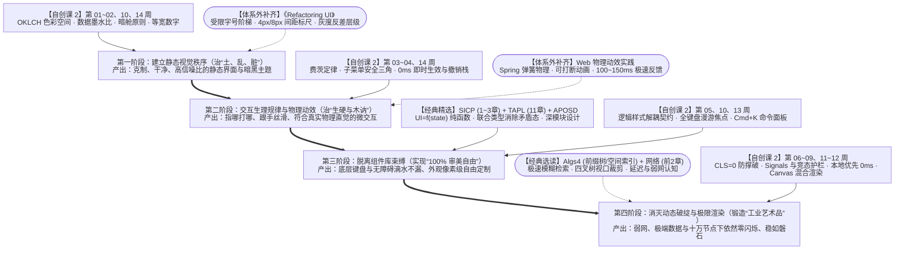

# UI 审美与现代交互工程学习路线（Design Engineer 路线）

* **适合人群**：想写出真正好看、高级、丝滑的前端界面的开发者；讨厌千篇一律的“AI 渐变大卡片模板”，向往做出像 Linear、Raycast、Figma、Vercel、Arc 浏览器那样既有审美质感、又经得起高强度使用的软件作品的人。
* **核心产出**：掌握 Design Engineer（设计工程师）的完整能力闭环——既有像素级的排版、色彩与动效审美，又有强类型状态机、无样式组件（Headless UI）与零闪烁异步架构的硬核工程功底。

---

## 一、 认知重塑：为什么你写的页面总是显得“土、乱、粗糙”？

很多想把前端写好看的人，常陷入两个极端误区：
1. 只练 CSS 花活，不修工程内功：临摹了一堆静态海报页，截图很好看；但一接上真实数据，数字跳动时整列乱晃、网络慢一点页面猛地抽搐、快速切标签页时旧数据闪现、长文本直接把按钮顶出屏幕——动态过程中的廉价破绽，一秒钟就能毁掉所有静态美感。
2. 被传统组件库绑架，失去审美自由：想实现自己设计的精致交互（如丝滑的 `Cmd+K` 命令面板、自定义下拉框），但因为写不好复杂的键盘焦点移动、无障碍属性和异步竞态，只能妥协去套用现成的重型组件库，结果做出来的东西永远带着一股“后台模板味”。

真正的顶级前端审美，是由“50% 视觉秩序与物理动效（皮囊）”+“50% 状态确定性与人机工程规律（骨架）”共同构成的。

咱们这套体系中的【自创课 2】[《人机状态边界与现代 UI/UX 工程》](../人机状态边界与现代UI工程/) 加上 3 本经典教材的精选章节，已经把最难的“骨架与工业秩序美”拉到了极致；你只需要按下面这四个阶段推进，并在第一、二阶段嵌入两块轻量的纯视觉与动效训练，就能走通这条路线。

---

## 二、 四阶段实战进阶路线

### 第一阶段：建立静态视觉秩序——先治“土、乱、脏”（约 2\~3 周）

> **阶段目标**：不靠玄学的“艺术细菌”，而是用严格的数学标尺、感知色彩空间与减法原则，让写出来的静态界面瞬间拥有克制、干净的高级感。

1. 科学色彩与暗黑模式质感
   * 必修章节：[《现代 UI 工程》第 10 周下半场：Design Tokens 与 OKLCH 感知色彩物理学](../人机状态边界与现代UI工程/16周完整教学与对抗工坊大纲#第-10-周-逻辑与样式解耦契约、设计变量与-oklch-感知色彩物理学)
   * 核心收获：彻底戒掉凭感觉在 RGB/HSL 色板里乱拖颜色的习惯。学会使用符合人眼真实感知亮度的 OKLCH 色彩空间，建立“基础色板 $\rightarrow$ 语义变量 $\rightarrow$ 组件变量”三层体系；掌握暗黑模式的核心美学——不用廉价的发光阴影，而是用背景明度的微妙递进（越靠近人眼的浮层明度越高）来表现空间层次。
2. 做减法的工业秩序美
   * 必修章节：
     * [《现代 UI 工程》第 01\~02 周：数据墨水比与高密度界面](../人机状态边界与现代UI工程/16周完整教学与对抗工坊大纲#第一模块信息密度与人机交互规律第-01---04-周)
     * [《现代 UI 工程》第 14 周：等宽数字对齐与“暗舱原则”](../人机状态边界与现代UI工程/16周完整教学与对抗工坊大纲#第-14-周-实用主义的高信噪比设计)
   * 核心收获：
     * 砍掉 40% 无意义的装饰边框、大圆角卡片与渐变噪音，用留白和对齐代替分割线；
     * 学会飞机驾驶舱的“暗舱原则”——页面 95% 的正常状态保持低调内敛的中性灰，把唯一高饱和度的色彩留给那 5% 真正需要用户注意的异常或主按钮（[第 04 周视觉权重对齐](../人机状态边界与现代UI工程/16周完整教学与对抗工坊大纲#第-04-周-视觉权重与防误触设计)）；
     * 凡是放数字、价格、时间的地方，强制开启 `font-variant-numeric: tabular-nums`（等宽数字对齐），让每一列数字像瑞士钟表一样严丝合缝。
3. 【体系外轻量补齐】版式与细节标尺
   * 推荐读物：《Refactoring UI》（Tailwind CSS 团队出品的实战画册，薄薄一本，周末两天就能看完）。
   * 重点吸收：如何制定受限的字号阶梯（Type Scale）与 `4px / 8px` 间距标尺；如何用字重（粗细）和文字灰度反差来建立层级，而不是靠把字放大；如何调出双层自然光影与微妙的 `1px` 内高光边框（Hairline Border）。

---

### 第二阶段：掌握交互生理规律与物理动效——治“生硬与木讷”（约 2\~3 周）

> **阶段目标**：明白为什么有的软件用起来“指哪打哪、跟手丝滑”，而有的软件让人烦躁；学会调教符合真实世界物理直觉的微交互。

1. 人机交互的生理与物理定律
   * 必修章节：[《现代 UI 工程》第 03\~04 周：费茨定律、转向定律、KLM 模型与防误触设计](../人机状态边界与现代UI工程/16周完整教学与对抗工坊大纲#第-03-周-交互的生理与物理规律)
   * 核心收获：
     * 懂得合理安排点击热区大小与距离（费茨定律），为多级悬浮菜单加上动态三角形安全区（Safe Triangle），彻底解决鼠标斜滑去点子菜单时菜单突然消失的恼人体验；
     * 砍掉打断心流的“您确定吗？”弹窗，换成像 Linear / Gmail 一样干脆利落的“0 毫秒即时生效 + 底部弹出可撤销提示（Undo Stack）”。
2. 【体系外轻量补齐】物理弹簧动效与编排（Micro-interactions）
   * 推荐补充：Emil Kowalski 的《Animations on the Web》理念或 Framer Motion / CSS Spring 物理动画实践。
   * 三条黄金动效铁律（与课程第 14 周紧密咬合）：
     1. 用弹簧物理（Spring Physics）代替固定时长曲线：真实世界没有匀速运动的物体。抽屉弹出、灵动岛展开、拖拽归位时，用刚度（Stiffness）和阻尼（Damping）驱动，并且保证动画随时可被用户的新操作平滑打断（Interruptible）；
     2. 高频操作必须极快：遵循课程 [第 14 周](../人机状态边界与现代UI工程/16周完整教学与对抗工坊大纲#第-14-周-实用主义的高信噪比设计) 原则——用户每天点几十次的菜单、命令面板和视图切换，动效必须控制在 $100\text{ms}\sim 150\text{ms}$ 以内（进入略缓，退出极快），绝不为了炫技拖慢操作员的手速；
     3. 保持空间连续性（Layout Transitions）：当列表项增删或面板变形时，利用共享布局过渡（FLIP 原理）让元素平滑移位，而不是生硬地瞬间闪现。

---

### 第三阶段：修炼编程抽象与逻辑样式解耦——实现“100% 审美自由”（约 4\~5 周）

> **阶段目标**：彻底摆脱“改不动第三方组件库样式”的束缚！只取体系内 3 本经典神作的核心精华，掌握通过状态契约（`data-state`）将底层交互状态机与外观样式 $100\%$ 解耦的工程内功。

这一阶段，你不需要去啃硬件和操作系统，只需精准攻克以下三本书的指定部分：

1. 《SICP》第 1 \~ 3 章（配合 [《SICP 导读》](../导读/SICP)）
   * 为什么对写 UI 有用：帮你建立起 $UI = f(\text{state})$ 的纯函数直觉（对应课程 [第 05 周上半场](../人机状态边界与现代UI工程/16周完整教学与对抗工坊大纲#第-05-周-声明式视图与强类型状态机)）。你会彻底明白组件树是怎么通过递归数据抽象搭出来的，以及为什么随意修改共享变量会让界面状态失控。
2. 《TAPL》第 11 章（复合类型与联合类型）
   * 为什么对写 UI 有用：直接对应课程 [第 05 周下半场：用强类型状态机消除矛盾状态](../人机状态边界与现代UI工程/16周完整教学与对抗工坊大纲#第-05-周-声明式视图与强类型状态机)。学会用联合类型（Sum Types）把界面的每一个状态严密包裹起来，从此你的页面上再也不会出现“一边显示加载骨架屏、一边残留着上一次报错提示”的破相瞬间。
3. 《软件设计的哲学》(APOSD) + 逻辑样式解耦契约与全键盘状态机
   * 必修章节：
     * `APOSD` 全书（不到 200 页，重点体会“深模块：接口极简，把复杂逻辑藏在内部”）；
     * [《现代 UI 工程》第 10 周上半场：逻辑与样式解耦契约（Headless UI）](../人机状态边界与现代UI工程/16周完整教学与对抗工坊大纲#第-10-周-逻辑与样式解耦契约、设计变量与-oklch-感知色彩物理学)
     * [《现代 UI 工程》第 13 周：全键盘操作、焦点状态机与 `Cmd+K` 命令面板](../人机状态边界与现代UI工程/16周完整教学与对抗工坊大纲#第-13-周-全键盘操作与快捷键系统)
   * 核心收获：学会用原生 `<dialog popover>` 与无样式底座避开浏览器历史 DOM 怪癖，通过纯数据属性契约（`data-state`）将交互状态与 CSS 彻底解耦，并在第 13 周亲手写出支持方向键漫游焦点、弹窗焦点锁定与恢复、模糊搜索过滤的全键盘状态机。从此以后，任何天马行空的视觉设计稿摆在你面前，你都能在不牺牲任何键盘操作体验的前提下，像素级自由地把样式画出来。

---

### 第四阶段：消灭“动态破绽”与极限渲染——锻造工业艺术品（约 4\~5 周）

> **阶段目标**：把你的界面从“静态看着美”推向“弱网、暴雪般的数据流、极端长文本下依然稳如磐石、快如闪电”的最高境界。

1. 防撑破容错与零布局抖动（$\text{CLS} = 0$）
   * 必修章节：[《现代 UI 工程》第 06 周：极端数据与防御性布局](../人机状态边界与现代UI工程/16周完整教学与对抗工坊大纲#第-06-周-极端数据与布局容错)
   * 核心收获：掌握 Defensive CSS（`min-width: 0`、逻辑属性、安全截断），无论后端返回 500 个字母的无空格哈希串、阿拉伯语从右向左（RTL）排版、还是 5 万行大列表，你的界面排版永远优雅从容，绝不乱跳一像素。
2. 零闪烁响应式、并发竞态护栏与 $0\text{ms}$ 本地优先架构
   * 必修章节：[《现代 UI 工程》第 07 \~ 09 周](../人机状态边界与现代UI工程/16周完整教学与对抗工坊大纲#第-07-周-细粒度响应式系统-signals-与主线程帧调度)
   * 核心收获：揭开 Linear 和 Figma 为什么操作起来完全感觉不到网络延迟的终极底牌——
     * 用细粒度响应式（Signals）和 $16.6\text{ms}$ 帧调度保证高频流式渲染不掉帧、不出现菱形依赖中间态闪烁；
     * 用 `Switch / Concat / Exhaust` 异步管道彻底拦截慢速旧请求覆盖新画面的尴尬；
     * 用本地优先同步引擎（Local-First）实现点击瞬间 $0\text{ms}$ 响应，断网也能丝滑操作。
3. 突破 DOM 极限的混合画布与物理几何验证护栏
   * 必修章节：[《现代 UI 工程》第 11 \~ 12 周](../人机状态边界与现代UI工程/16周完整教学与对抗工坊大纲#第-11-周-canvas-高性能渲染与-dom-混合架构)
   * 核心收获：
     * 学会用四叉树空间索引 + Canvas $120\text{FPS}$ 渲染与按需挂载原生 DOM 输入框的混合架构，做出像 Figma / 无限白板那样同屏十万个节点依然丝滑的画布应用；
     * 学会编写确定性 UI 验证器（TypeScript 强类型组件契约 + 无头浏览器二维几何碰撞与对比度断言引擎）——用 `tsc` 编译期封死非法状态组合与裸标签，再用无头浏览器真实渲染后的 `BoundingBox` 几何计算捕获文字重叠、容器撑破、$\text{CLS} > 0$ 与像素对比度不足，从物理层面守住你的审美底线。

---

## 三、 断舍离指南：走这条路线，哪些书可以先不看？

为了避免在战线过长时耗尽热情，如果你当前的核心目标是成为顶级的 UI 审美与交互工程师（Design Engineer），体系内的其余内容可以按如下优先级裁剪：

| 处理方式 | 涉及教材与课程 | 原因与建议 |
| :---: | :--- | :--- |
| 🔥 核心精读 | `APOSD`、`SICP`（1\~3章）、`TAPL`（11、15章）、【自创课 2】现代 UI/UX 工程（全 16 周） | 直接决定你代码的优雅度、状态机的严密程度与界面的最终质感。 |
| ⚡ 按需选读 | `Algs4`（仅看树遍历、前缀树 Trie 与空间索引）、`Kurose 网络`（仅看前 2 章 HTTP 与延迟认知） | 前缀树可用于手写 `Cmd+K` 命令面板的极速搜索；网络延迟认知有助于理解乐观更新与弱网交互。只花几个小时挑着看即可。 |
| ⏸️ 暂缓/跳过 | `Nand2Tetris`、`OSTEP`、`DDIA`、`Sipser`、`D2L`、【自创课 1】计算机系统演化 | 这些属于底层硬件、内核、分布式存储与大模型推理基础设施。除非你后续打算转向全栈架构或 AI 底层系统，否则前期完全可以先放一放，轻装上阵。 |
